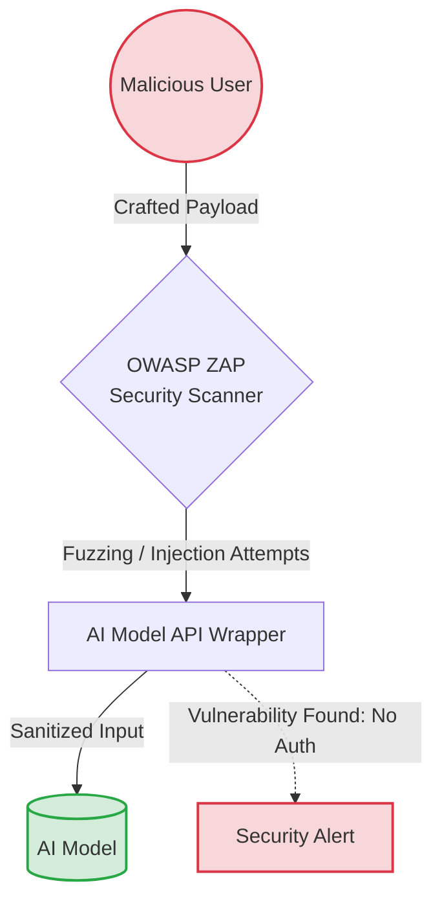
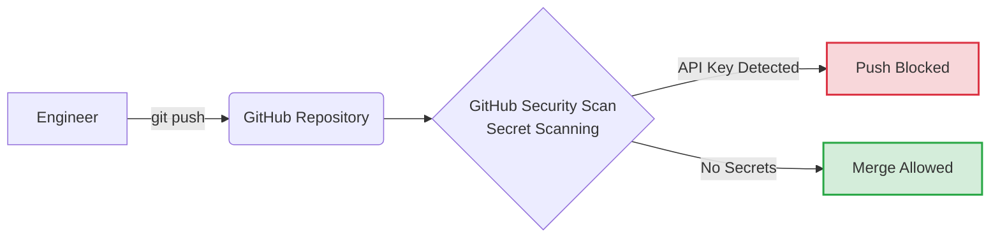
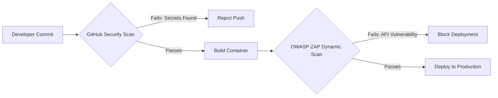
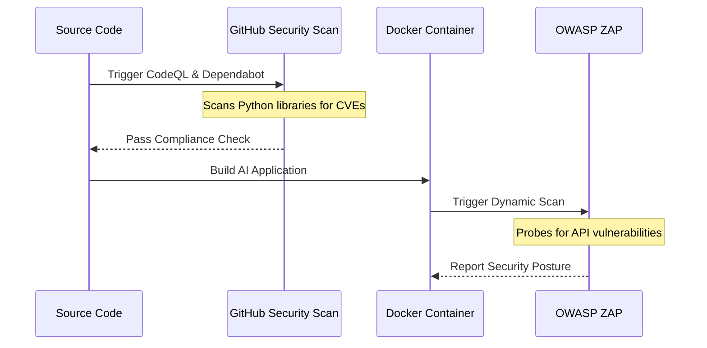

# SECURITY IN AI SYSTEMS OPERATIONS

**Session Time:** 120 minutes 

---

## Table of Contents
1. Describing Common Vulnerabilities in AI Systems and Data Pipelines
2. Applying Access Control and Encryption Practices
3. Evaluating System Security Posture
4. Lab: Security Audit Simulation
5. Wrap-Up and Reflection

---

## Learning Objectives

By the end of this module, participants will be able to:

1. Describe common vulnerabilities in AI systems and data pipelines. 
2. Apply access control and encryption practices to secure operational environments. 
3. Evaluate system security posture using vulnerability scans and compliance checks. 

---

## Session Breakdown

| Segment | Topic                                                              | Duration (minutes) |
|---------|--------------------------------------------------------------------|--------------------|
| 1       | Describing Common Vulnerabilities in AI Systems and Data Pipelines | 20                 |
| 2       | Applying Access Control and Encryption Practices                   | 20                 |
| 3       | Evaluating System Security Posture                                 | 20                 |
| 4       | Lab: Security Audit Simulation                                     | 60                 |

---

## 1. Describing Common Vulnerabilities in AI Systems and Data Pipelines

To understand the fundamentals of securing AI systems and protecting sensitive data, you must first be able to identify where the weaknesses lie. AI systems face traditional software vulnerabilities as well as AI-specific threats, such as data poisoning and prompt injection. 

### Concepts: AI Vulnerability Landscapes
* **Prompt Injection:** 
  
  Malicious inputs designed to manipulate the output of a Large Language Model (LLM) or bypass its safety guardrails.

* **Data Pipeline Poisoning:** 
  
  Attackers compromising the training or fine-tuning data to alter the model's behavior over time.

* **API Exposure:** 
  
  Unsecured inference endpoints that allow unauthorized access to the model, leading to data loss or model theft.

### Tools Used: OWASP ZAP
OWASP ZAP (Zed Attack Proxy) is an open-source web application security scanner. In an AI operations context, it is used to probe the API wrappers surrounding your machine learning models for common web vulnerabilities (like injection flaws or broken authentication) before they are deployed to production.

### Practical Example
If your AI model is served via a REST API, you can configure OWASP ZAP to actively attack the endpoint.

**Scenario:** You run OWASP ZAP against your new internal text-summarization AI API. ZAP discovers that the endpoint lacks rate limiting, meaning an attacker could flood the API, causing a Denial of Service (DoS) and driving up compute costs by forcing the GPU to process infinite requests.

---

## 2. Applying Access Control and Encryption Practices

Once vulnerabilities are understood, the next step is to apply access control and encryption practices to secure operational environments. Protecting sensitive data requires ensuring that only authenticated identities can access the model and that data is encrypted both in transit and at rest.

### Concepts: Securing the Environment

* **Role-Based Access Control (RBAC):**
  
  Ensuring that a frontend application has only "read" (inference) access to a model, while only CI/CD pipelines have "write" (deployment) access.

* **Encryption:**
  
  Using TLS for API requests and encrypting training data storage volumes.

### Tools Used: GitHub Security Scan (Secret Scanning)

GitHub Security Scan includes tools to apply DevSecOps principles directly in your code repository. One critical feature is Secret Scanning, which prevents developers from accidentally committing hardcoded API keys or access tokens into the repository.

### Practical Example

A developer is writing a Python script to query a proprietary OpenAI or internal Hugging Face model and accidentally pastes their live API key into the `app.py` file.

**Scenario:** 

GitHub Security Scan intercepts the commit. It detects the pattern of a sensitive access token and blocks the push, preventing the credential from being leaked. This enforces access control by ensuring credentials are appropriately managed via secure environment variables or a key management service.

---

## 3. Evaluating System Security Posture

Security is not a one-time setup. It is necessary to evaluate the system security posture continuously using vulnerability scans and compliance checks. This ensures that new dependencies or architectural changes do not introduce new risks to the AI pipeline.

### Concepts: Continuous Compliance

* **DevSecOps:** 
  
  Integrating security practices into the DevOps process. Every time an AI model is updated, security checks run automatically.

* **Vulnerability Scanning:** 
  
  Scanning Docker images and Python dependencies (`requirements.txt`) for Known Vulnerabilities and Exposures (CVEs).

### Visualizing the Security Pipeline
Security tools integrate into the CI/CD pipeline in the following way:

### Tools Used: GitHub Security Scan (Dependabot/CodeQL) and OWASP ZAP

By chaining these tools, you create an automated compliance pipeline. GitHub Security Scan checks the static code and dependencies, while OWASP ZAP checks the dynamic, running application.

### Practical Example

You configure a GitHub Actions pipeline to evaluate the security posture of your AI application automatically on every pull request.

**Scenario:** 

The GitHub Security Scan detects that your `requirements.txt` includes an outdated version of TensorFlow with a known critical vulnerability. The pipeline fails the compliance check and alerts the team to update the library before the container is ever built or deployed.

---

## 4. Lab: Security Audit Simulation

**Objective:** Security Audit Simulation – Learners identify and patch vulnerabilities in a sandboxed AI system environment. They apply DevSecOps principles to secure AI pipelines, protect data integrity, and implement monitoring for potential threats. The lab also introduces AI security wrappers and tools that help manage model access, prevent data loss, and defend against prompt injection and other AI-specific vulnerabilities.

*(Please refer to the lab platform for complete instructions, starter code, and access to the sandboxed AI environment).*

---

## 5. Wrap-Up and Reflection

**Reflection Questions:**

1. How does scanning for vulnerabilities in an AI model's API wrapper differ from defending against prompt injection attacks?
2. Why is implementing DevSecOps principles, such as automated GitHub Security Scans, critical for maintaining data integrity in fast-moving AI pipelines?

---

## Resources

* [OWASP Top 10 for Large Language Model Applications](https://owasp.org/www-project-top-10-for-large-language-model-applications/)
* [OWASP ZAP Documentation](https://www.zaproxy.org/docs/)
* [GitHub Advanced Security Features](https://docs.github.com/en/get-started/learning-about-github/about-github-advanced-security)

