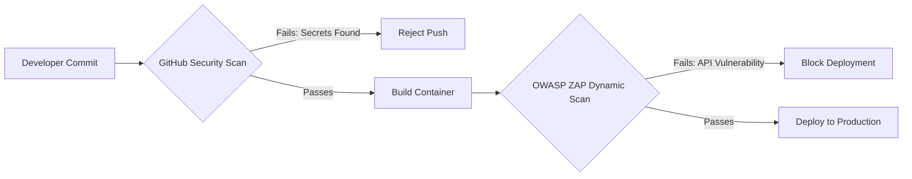

# Instructor Guide: Security in AI Systems Operations

## Module Overview
In this module, instructors will guide learners to understand the fundamentals of securing AI systems and protecting sensitive data. The session focuses on teaching students to identify vulnerabilities, manage access, and apply DevSecOps principles to operational environments. 

## Learning Objectives
By the end of this session, learners will be able to:
* Describe common vulnerabilities in AI systems and data pipelines.
* Apply access control and encryption practices to secure operational environments.
* Evaluate system security posture using vulnerability scans and compliance checks.

## Session Pacing Guide (120 Minutes total)

| Duration   | Segment                            | Instructor Action                                                                                                                                                                                         |
|:-----------|:-----------------------------------|:----------------------------------------------------------------------------------------------------------------------------------------------------------------------------------------------------------|
| **20 min** | **AI Vulnerability Landscape**     | Define AI-specific threats such as prompt injection and data poisoning. Differentiate these from traditional API vulnerabilities.                                                                         |
| **40 min** | **DevSecOps & Scanning Demo**      | Live demonstration: Run a GitHub Security Scan to detect an exposed API key. Demonstrate using OWASP ZAP to fuzz an AI model's API wrapper.                                                               |
| **60 min** | **Lab: Security Audit Simulation** | Facilitate the lab where learners identify and patch vulnerabilities in a sandboxed AI system environment. Guide them in applying DevSecOps principles to protect data integrity and monitor for threats. |

---

## Delivery Notes & Teaching Tips

### 1. The "Wrapper" Concept
* **Securing the API:** 
  
  Emphasize that while the math behind the AI model is complex, the operational vulnerabilities are usually found in the traditional software wrapping the model (e.g., the Python Flask or FastAPI endpoints). 

* **Shift-Left Security:** 
  
  Introduce the concept of "shifting left"—finding vulnerabilities in the GitHub repository via code scanning before the application reaches the Kubernetes cluster.

### 2. Visualizing the Security Pipeline
Draw or display how security tools integrate into the CI/CD pipeline:

---

## Common Student Issues & Solutions

| Issue                                                    | Potential Cause                                                                                            | Solution                                                                                                                                                                                                |
|----------------------------------------------------------|------------------------------------------------------------------------------------------------------------|---------------------------------------------------------------------------------------------------------------------------------------------------------------------------------------------------------|
| **GitHub Push Blocked**                                  | GitHub Security Scan detected a hardcoded API key or access token in the commit.                           | Explain that this is the tool working correctly! Guide the student to remove the key, use environment variables (`.env`), and securely manage secrets.                                                  |
| **ZAP Scanner Returns False Positives**                  | The automated scanner flags standard AI response latency as a potential "Denial of Service" vulnerability. | Teach learners how to interpret ZAP alerts. Explain the difference between expected model inference time and an actual unsecured, un-rate-limited endpoint.                                             |
| **Confusion between Prompt Injection and SQL Injection** | Applying traditional database security mindsets to LLMs.                                                   | Clarify that SQL injection targets the database backend, while prompt injection manipulates the AI's logic directly. Show an example of an AI security wrapper used to defend against prompt injection. |
| **Container Scan Fails in CI**                           | Outdated base images or Python dependencies in `requirements.txt` contain Known Vulnerabilities (CVEs).    | Direct students to update their library versions to the patched releases and re-trigger the build pipeline.                                                                                             |

---

## Debrief Questions

1. "In the Security Audit Simulation, how did integrating GitHub Security Scans directly into the repository change your workflow compared to scanning a deployed application?"
2. "Why is securing the data pipeline just as important as securing the final AI model endpoint?"
3. "If OWASP ZAP finds an unauthenticated endpoint in your AI service wrapper, what access control practices could you apply to secure it?"

---

## Resources for the Instructor

* **Reference:** 
  [OWASP Top 10 for Large Language Model Applications](https://owasp.org/www-project-top-10-for-large-language-model-applications/)
  * [About GitHub Advanced Security](https://docs.github.com/en/get-started/learning-about-github/about-github-advanced-security)
* **AI Prompt Bank:** Keep these handy to share with students who are stuck:
  * *"Write a Python script using the `python-dotenv` library to load an OpenAI API key securely instead of hardcoding it."*
  * *"Explain the concept of 'Data Poisoning' in machine learning to a beginner."*
